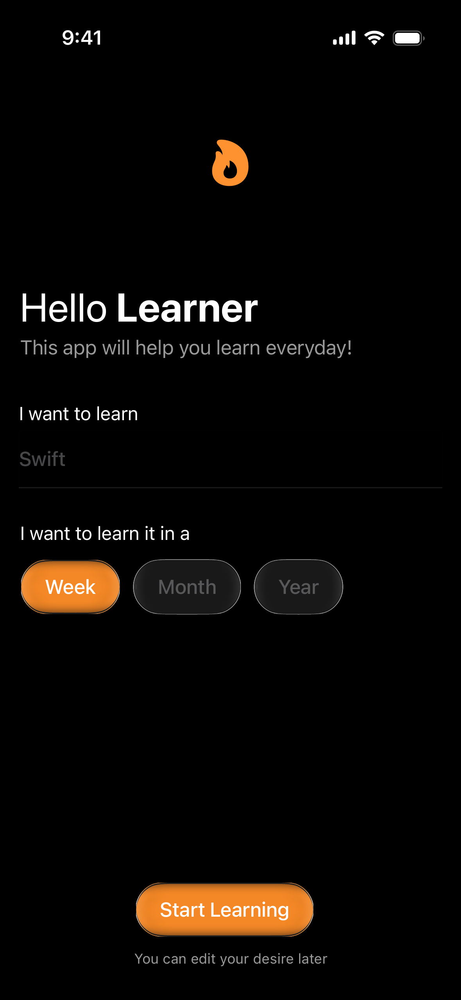
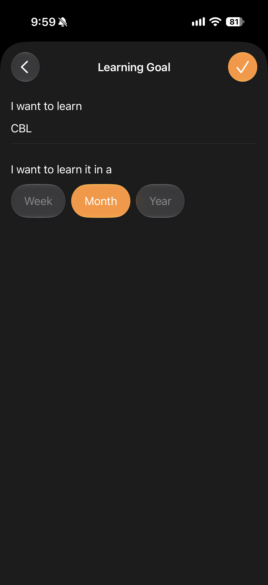
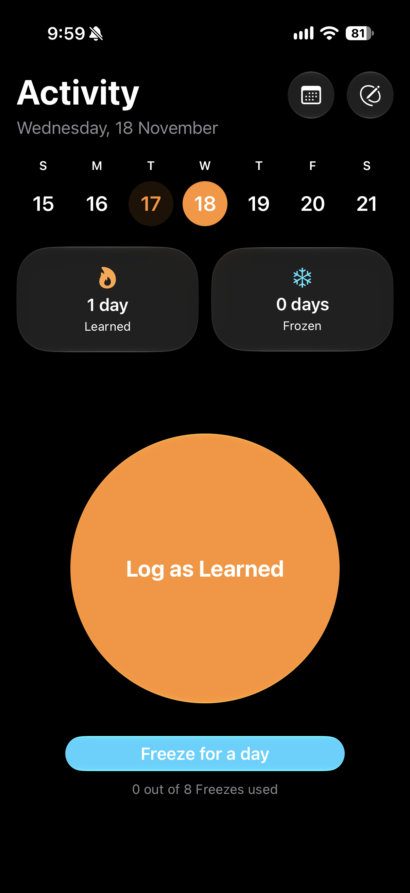
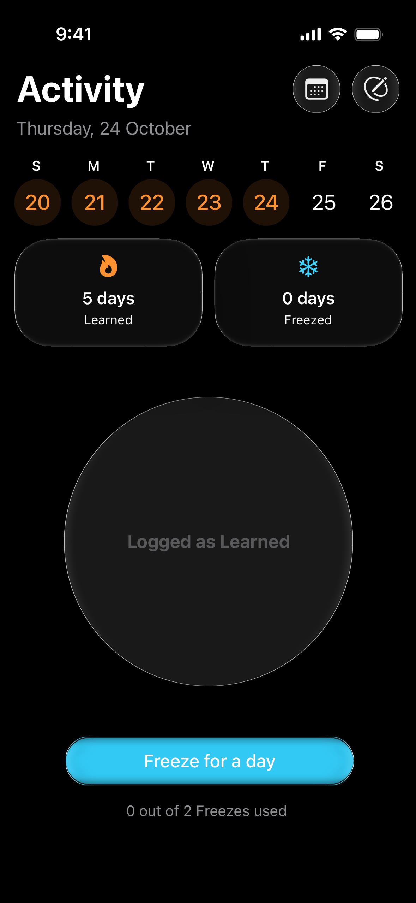
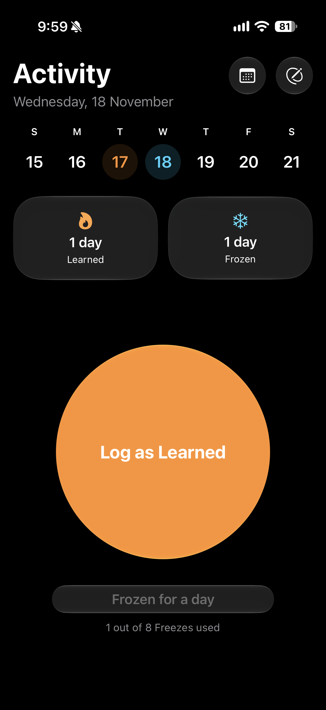
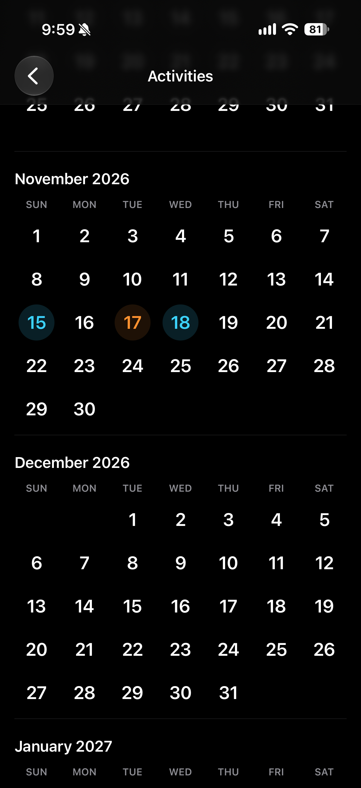
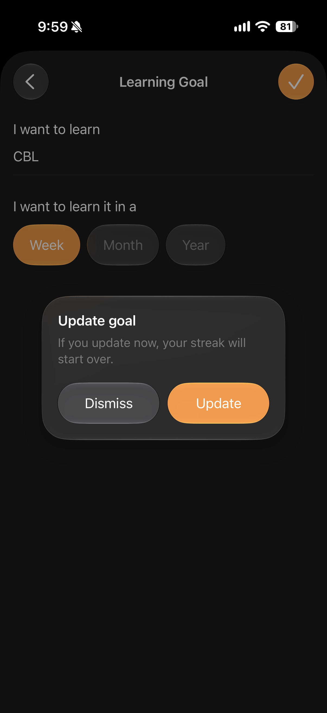
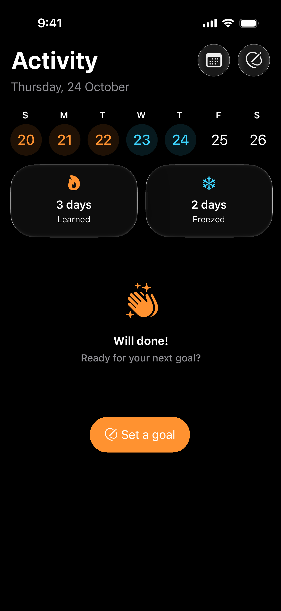
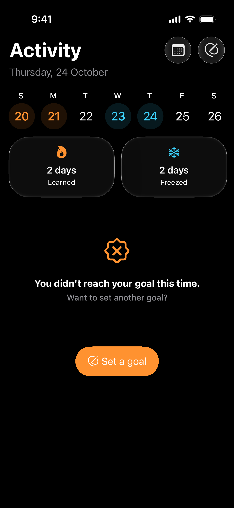

# Journey 

Journey is an iOS app designed to help users stay consistent with learning something new. Users can set personal learning goals for a week, month, or year, track their daily progress, and use Freeze days when they need a break. With a 32-hour consistency rule and a calendar to view their learning history, Journey encourages users to build learning habits and keep moving toward their goals.

## Main Features

- **Set a Learning Goal:** Choose a topic and commit to learning it for a week, month, or year.
- **Record a Learning Day:** Tap **Learned** to record your learning activity for the day.
- **Freeze a Day:** Use a Freeze when you need a break without breaking your streak. Each duration has a different limit: 2 Freezes for a week, 8 for a month, and 96 for a year.
- **Maintain Your Streak:** Journey uses a 32-hour consistency rule. Recording either Learned or Freeze within 32 hours of starting a goal or the previous recorded action keeps the streak active. If more than 32 hours pass, the streak breaks and the current goal ends unsuccessfully.
- **Track Your Progress:** View your learned days, used and remaining Freezes, and learning progress.
- **View Learning History:** Use the calendar to see which days were marked as Learned or Freeze, including activity from previous goals.
- **Update Your Goal:** Change your learning topic or duration. Updating starts a new goal with fresh progress while keeping your previous learning records.
- **View Goal Results:** At the end of a goal, Journey checks whether the completion requirements were met and displays the outcome.

## App Screenshots

These screens show how Journey works, from setting a learning goal to tracking daily progress and reviewing the result.

### Getting Started

| Onboarding | Edit Learning Goal |
|:---:|:---:|
|  |  |

### Daily Learning

| Activity | Learned | Freeze |
|:---:|:---:|:---:|
|  |  |  |

### Calendar and Goal Updates

| Learning Calendar | Update Confirmation |
|:---:|:---:|
|  |  |

### Goal Results

| Goal Completed | Goal Not Completed |
|:---:|:---:|
|  |  |

## Technologies Used

- **Swift** — App logic and data models
- **SwiftUI** — Screens, navigation, and reusable UI components
- **MVVM Architecture** — Organizing models, views, and view models
- **Foundation** — Handling dates, calendars, and time calculations
- **UserDefaults & Codable** — Saving learning goals and activity records locally
- **Liquid Glass** — Native iOS visual effects used in the interface
- **Xcode** — App development and testing

## From Design to Code

Journey's visual design was provided to me, and my role was to turn it into a functional iOS application using SwiftUI.

I focused on building the screens, creating reusable components, and connecting the interface to the app's functionality. One of the challenges was making sure my implementation stayed consistent with the provided design while still behaving naturally on iOS.

I also explored Apple's native Liquid Glass effects and how to incorporate them into the existing visual style.

## What I Implemented

- Built the app's screens and navigation using SwiftUI.
- Created reusable components for buttons, text fields, calendar dates, and other interface elements.
- Organized the project using MVVM architecture.
- Implemented learning goals with Week, Month, and Year durations.
- Developed the Learned and Freeze actions, allowing users to record one activity per day.
- Implemented the 32-hour consistency rule that determines whether a learning streak remains active or breaks.
- Added Freeze limits based on the selected goal duration.
- Implemented learning progress tracking and goal completion conditions.
- Used UserDefaults and Codable to save goals and activity records locally.
- Connected the calendar to learning activity and preserved previous records when goals were updated.

## What I Learned

Working on Journey helped me better understand how to turn an existing design into a working iOS application.

I gained more experience with SwiftUI, state management, navigation, reusable components, MVVM architecture, and local data persistence.

The part that challenged me the most was implementing the learning logic, especially the 32-hour streak rule.

Unlike a traditional streak that depends only on consecutive calendar days, Journey uses a 32-hour window between activities. I had to consider what should happen when a user records a learning day, uses a Freeze, reaches the Freeze limit, or exceeds the allowed time.

I also learned how important it is to test different scenarios, especially when working with dates, time intervals, and goal completion conditions.

This project helped me realize that even an interface that looks simple can have a lot of logic behind it.

## Run the Project

1. Clone or download this repository.
2. Open `LearningJourney.xcodeproj` in Xcode.
3. Select an available iPhone simulator.
4. Build and run the app.

**Developed by Elaf Fareed**

My work on Journey focused on implementing the provided visual design using SwiftUI, building the app's functionality, and connecting the interface to its underlying logic.

**GitHub:** [ElafFareed](https://github.com/ElafFareed)
